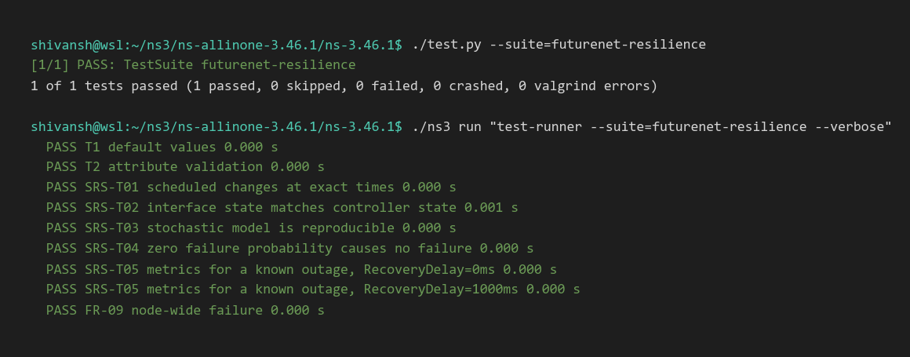
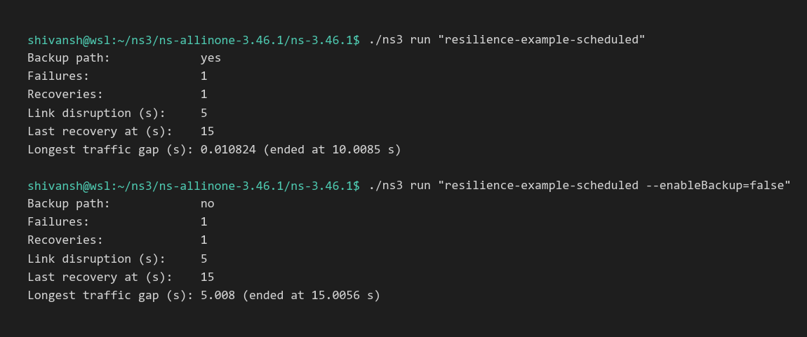
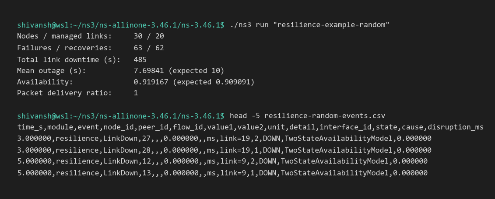
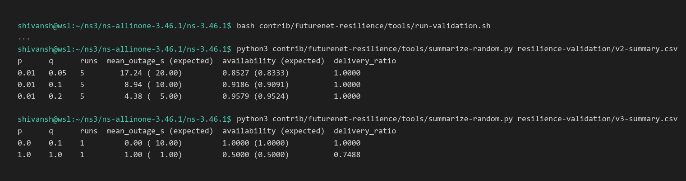

# futurenet-resilience (M04 – Dynamic Link Failure and Network Resilience)

Team: **The LANlords**. The members are Aman Soni, Abir Barman, Deepak Kumar and Shivansh Gautam.

## Purpose

This ns-3.46.1 contrib module has three jobs:

- It makes links (or whole nodes) fail and recover, either at fixed times or at random.
- It lets the scenario's routing protocol react to those failures.
- It measures how long the network was disrupted.

The module does **not** add a routing protocol. Rerouting is done by standard ns-3 routing, in the examples by `Ipv4GlobalRouting` with `RespondToInterfaceEvents=true`.

## Dependencies

- ns-3.46.1
- Module library: `internet` (which pulls in `network` and `core`)
- Examples also need: `point-to-point`, `applications`, `flow-monitor`
- Optional plots: Python 3 with `matplotlib`

## Build

Use Linux or WSL2 Ubuntu. The native Windows build of ns-3 is experimental.

```bash
sudo apt install g++ cmake ninja-build python3 git
wget https://www.nsnam.org/releases/ns-allinone-3.46.1.tar.bz2
tar xjf ns-allinone-3.46.1.tar.bz2
cp -r futurenet-resilience ns-allinone-3.46.1/ns-3.46.1/contrib/
cd ns-allinone-3.46.1/ns-3.46.1
./ns3 configure --enable-examples --enable-tests \
    --enable-modules="futurenet-resilience;point-to-point;applications;flow-monitor"
./ns3 build
```

`--enable-modules` only builds what this project needs, which is much faster than building all of ns-3. Drop that flag to build everything.

## Run the tests

```bash
./test.py --suite=futurenet-resilience
```

## Basic usage

```cpp
#include "ns3/futurenet-resilience-module.h"

// After IPv4 addresses are assigned:
Ptr<ScheduledAvailabilityModel> schedule = CreateObject<ScheduledAvailabilityModel>();
schedule->AddDownInterval(Seconds(10), Seconds(5));   // down from 10 s to 15 s

ResilienceHelper resilience;
Ptr<FailureController> link = resilience.Install(linkDevices, schedule);

Ptr<ResilienceMetricsCollector> metrics = CreateObject<ResilienceMetricsCollector>();
metrics->EnableCsvOutput("events.csv");
metrics->Monitor(link);
// ... Simulator::Run(); then metrics->GetTotalDisruptionTime()
```

To use random failures, set the model type on the helper. Then call `Install(devices)` without a model.

```cpp
resilience.SetAvailabilityModel("ns3::TwoStateAvailabilityModel",
                                "FailureProbability", DoubleValue(0.05),
                                "RecoveryProbability", DoubleValue(0.2));
```

To fail a whole node (FR-09), use `resilience.InstallOnNode(node, model)`.

## Examples

| Example | Guideline name | SRS name | What it shows |
|---|---|---|---|
| `resilience-example-scheduled` | example-basic | example-scheduled | 4 nodes, two paths. The primary link fails at 10 s for 5 s and traffic reroutes. |
| `resilience-example-random` | example-advanced | example-random | A 6×5 grid (30 nodes) with 20 randomly failing links. Prints availability and disruption stats. |

```bash
./ns3 run "resilience-example-scheduled --failureStart=10s --failureDuration=5s"
./ns3 run "resilience-example-scheduled --enableBackup=false"
./ns3 run "resilience-example-random --recoveryProbability=0.05 --RngRun=3"
```

Each example has `--PrintHelp` to list all of its options.

The examples write these output files:

- `<prefix>-events.csv`: one row per interface event. Columns: `time_s,module,event,node_id,peer_id,flow_id,value1,value2,unit,detail,interface_id,state,cause,disruption_ms`
- `<prefix>-throughput.csv`: written by the scheduled example. Columns: `time_s,throughput_mbps`
- `<prefix>-summary.csv`: written by the random example. It gets one row per run, appended.

For plots and validation sweeps, see [tools/](tools/).

## Sample output

These outputs come from ns-3.46.1 (`default` build profile, seed 1) in WSL2 Ubuntu. The runs used `--outputPrefix` to write files into a separate folder, and the commands below are shown with the default prefix.

**Tests:** all 9 test cases pass.



**Scheduled example (V1):** with the backup path, traffic reroutes and the longest gap is 0.011 s. Without the backup path, traffic stops for the whole 5 s outage.



**Random example:** a 30-node grid with 20 randomly failing links, plus the start of the event CSV.



**Validation (V2/V3):** a longer mean outage gives lower availability. The boundary cases match the closed-form values.



## SRS traceability

| Requirement | Where |
|---|---|
| FR-01 UP/DOWN state | `LinkAvailability`, `FailureController::GetCurrentState` |
| FR-02 scheduled times | `ScheduledAvailabilityModel` (test SRS-T01) |
| FR-03 stochastic model with ns-3 streams | `TwoStateAvailabilityModel::AssignStreams` (tests SRS-T03, SRS-T04) |
| FR-04 apply state to interfaces | `FailureController::ApplyState` with `Ipv4::SetDown`/`SetUp` (test SRS-T02) |
| FR-05 LinkDown/LinkUp traces | `FailureController` trace sources (test SRS-T05) |
| FR-06 disruption, failures, recoveries | `ResilienceMetricsCollector` (test SRS-T05) |
| FR-07 traffic disruption and rerouting | `resilience-example-scheduled` |
| FR-09 node-wide failure (R) | `ResilienceHelper::InstallOnNode` (test FR-09) |
| AC-05 supported devices | See "Known limitations" below |

## Known limitations

- **Supported devices:** this works on any NetDevice that has its own IPv4 interface, such as point-to-point, CSMA or SimpleNetDevice, because failure is done with `Ipv4::SetDown`. The examples and tests use point-to-point and SimpleNetDevice only.
- **Shared media:** on CSMA or Wi-Fi, setting one interface down cuts that node off from *every* neighbor on the medium. Pairwise failure on a shared wireless medium is **not supported**.
- **Not implemented:** the DEGRADED state (FR-08, R) and correlated/regional failures (FR-10, O).
- **IPv4 only:** IPv6 interfaces are not touched.
- **Unreachable addresses:** a packet sent to an address on a failed interface is unreachable even if the node is reachable by another path. The examples address sinks on links that never fail.
- **Recovery delay:** this is modeled only as extra time before `SetUp()`. Routing convergence time comes from the routing protocol. Global routing converges instantly, while RIP or OLSR would show real convergence delay.
- **Stochastic timing:** the stochastic model is discrete-time, so state changes happen only at multiples of `EvaluationInterval`. The SRS parameters `MeanUpTime` and `MeanDownTime` are not attributes. They follow from the probabilities, as explained in [doc/](doc/futurenet-resilience.md).
